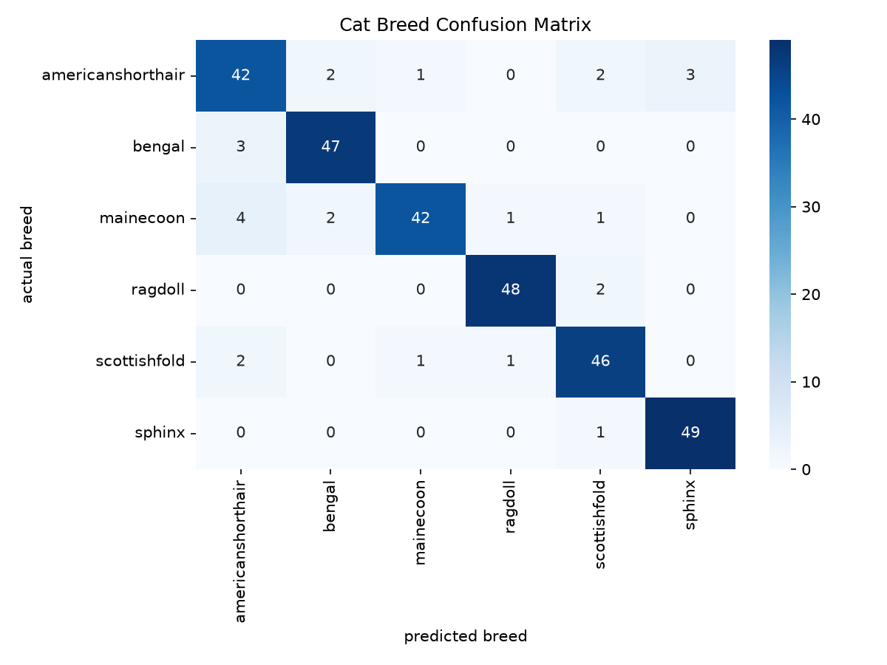

# Cat Breed Prediction Model

Cat Breed Prediction Model uses the Kaggle Dataset below to train a model that classifies cat breeds from an image.

## Why I built it

Purdue DS club application. Wanted to learn how to use ResNet, Layer Freezing and Transfer Learning. It also portrays understanding of image based machine learning.

## Dataset

 - The data is from the Kaggle dataset: [solothok/cat-breed](https://www.kaggle.com/datasets/solothok/cat-breed)
 - The dataset contains 6 breeds and 300 test images, each breed having 50 images.
 - There is 1,199 train images with  breeds: American Shorthair, Bengal, Maine Coon, Scottish Fold, Ragdoll, Sphynx 
 - Training: 80/20(train/validation split)

## Approach
- Used transfer learning in order to use the pretrained models from ResNet to increase prediction accuracy with less computing power. 
- Used ResNet18 to use the pretrained model for general visual features, and specifically Resnet18 since its small and fast which is optimal for a 6 breed small dataset. 
- Froze the pretrained layers and just modified the final layer to keep the knowledge from the pretrained data. 
- Used random crops, flips and rotations as augmentation
- Color augmentation is not used so that the cat breeds won't be predicted inaccurately since color is a major contributor to breed prediction.

## Results

Test accuracy 91.33%. American Shorthair was the hardest breed, with the lowest F1 (0.83). Maine Coon tied it on recall (0.84). 


## What I learned / next steps

The validation accuracy (91.25%) ended up higher than the training accuracy (83.65%). This is caused by data augmentation: training images are randomly cropped, flipped and rotated, which makes them harder to classify, while validation images are left unchanged. This also shows the model is not overfitting, since overfitting would make training accuracy much higher than validation accuracy.

As a next step, unfreezing the last few ResNet18 layers and training them with a smaller learning rate could improve accuracy further, though it would increase the risk of overfitting.

## How to run

In order to install the model and run it yourself: 
```bash
conda create -n cat-breed-cv python=3.11
conda activate cat-breed-cv
pip install -r requirements.txt
jupyter notebook prediction_model.ipynb
```

- Also shouldn't be forgotten that the code includes a torch.device("mps") for Apple Silicon Macs. Might have to change it to "cpu" or "cuda".